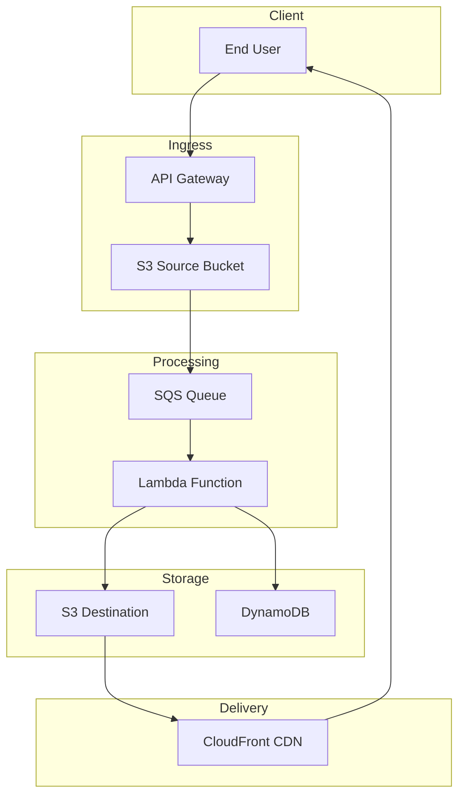

# Project Report: Serverless Image Processing Pipeline

## Executive Summary

**Project:** AWS Solutions Architect - Associate Certification Project 2  
**Status:** Completed - Infrastructure Provisioned  
**Date:** October 2026  
**Repository:** https://github.com/GibzB/Manara-Project-Solutions-Architect

This project implements a serverless image processing pipeline that demonstrates AWS best practices for event-driven architectures. The system automatically processes images uploaded to S3, performs transformations, and delivers results globally via CloudFront.

---

## Project Overview

### Problem Statement
Create an image processing pipeline that:
- Accepts user uploads via pre-signed URLs
- Processes images with resizing and watermarking
- Stores processed images for global delivery
- Provides job status tracking and notifications
- Scales automatically to handle variable loads

### Solution Architecture
The pipeline uses a fully serverless architecture with no managed EC2 instances required, ensuring maximum scalability and minimal operational overhead.

---

## Completed Infrastructure

### S3 Buckets
| Bucket Name | Purpose |
|-------------|---------|
| source-images-dev | Accept user uploads and trigger events |
| processed-images-dev | Store processed images |
| processing-temp-dev | Temporary intermediate files |
| s3-access-logs-dev | S3 access logging |

### SQS Queues
| Queue Name | Purpose |
|------------|---------|
| image-processing-queue-dev | Main processing queue |
| image-processing-dlq-dev | Failed message handling |

### Other AWS Resources
- DynamoDB table: image-processing-metadata
- CloudFront distribution: Serving processed images
- SNS topic: image-processing-notifications
- IAM roles and policies for all services

---

## Architecture Components

### Ingress Layer
- **API Gateway**: Pre-signed URL generation for secure uploads
- **S3 Source Bucket**: Receives user uploads and publishes events to SQS

### Processing Layer
- **SQS Queue**: Decouples upload events from processing work
- **Lambda Function**: Image processing (resize, watermark)
- **Step Functions**: Workflow orchestration

### Storage Layer
- **S3 Destination Bucket**: Stores processed images
- **DynamoDB**: Job metadata storage

### Delivery Layer
- **CloudFront**: Global CDN for image delivery
- **SNS**: Notifications for job completion/failure

---

## AWS Services Used

| Service | Purpose | Cost Consideration |
|---------|---------|-------------------|
| S3 | Image storage with lifecycle policies | $0.023/GB-month (Standard) |
| SQS | Event decoupling and retry | $0.40/million requests |
| Lambda | Image processing | $0.20/million requests |
| CloudFront | Global CDN | $0.085/GB (US/Canada) |
| DynamoDB | Job metadata storage | $0.25/GB (On-Demand) |
| SNS | Notifications | $0.50/million requests |
| Step Functions | Workflow orchestration | $0.025/state transition |
| CloudWatch | Monitoring | Free tier included |

**Estimated Monthly Cost:** $10-50/month (depending on usage volume)

---

## Key Features

### Event-Driven Architecture
- S3 event notifications trigger SQS queue
- Lambda polls SQS for processing jobs
- Decoupled design enables horizontal scaling

### Image Processing
- Resize to three resolutions (thumbnail 150x150, medium 640x640, full 2048px max)
- Watermark overlay with configurable settings
- Support for JPEG, PNG, GIF, WebP formats

### Reliability
- Dead-letter queue for failed messages
- Retry logic with exponential backoff
- Auto-deletion of temporary files after 1 day

### Security
- S3 buckets with public access blocked
- Origin Access Identity for CloudFront
- IAM roles with least privilege
- KMS encryption for DynamoDB

---

## Getting Started

### Prerequisites
- AWS CLI configured
- Node.js 18.x or higher
- AWS CDK v2 installed

### Deployment

```bash
cd cdk

# Bootstrap CDK (first time only)
npx cdk bootstrap

# Deploy infrastructure
npx cdk deploy
```

### Post-Deployment
1. Upload test image to Source Bucket
2. Verify processed images in Destination Bucket
3. Test CloudFront URL delivery
4. Check DynamoDB for job metadata

---

## Architecture Diagram



---

## Project Deliverables

- Solution Architecture Diagram: serverless-image-processing-pipeline/architecture.drawio
- GitHub Repository: https://github.com/GibzB/Manara-Project-Solutions-Architect
- Requirements Document: serverless-image-processing-pipeline/requirements.md
- Design Document: serverless-image-processing-pipeline/design.md
- Implementation Tasks: serverless-image-processing-pipeline/tasks.md

---

## Repository Structure

```
Manara-Project-Solutions-Architect/
├── serverless-image-processing-pipeline/
│   ├── architecture.drawio          # Architecture diagram (draw.io)
│   ├── requirements.md              # Project requirements
│   ├── design.md                    # System design document
│   └── tasks.md                     # Implementation tasks
├── cdk/
│   ├── dist/                        # Compiled CDK code
│   ├── stacks/
│   │   └── image-processing-pipeline-stack.ts
│   └── index.ts                     # CDK entry point
├── scripts/                         # Deployment scripts
├── README.md                        # Project overview
└── PROJECT_REPORT.md                # This report
```

---

## Next Steps

1. **Complete Lambda Functions**: Implement image processing logic
2. **Complete Integration**: Connect Lambda to DynamoDB and Step Functions
3. **Testing**: Write unit, integration, and end-to-end tests
4. **Documentation**: Finalize deployment scripts and user guide
5. **Deployment**: Deploy to AWS and create demo video

---

**Report Generated:** October 29, 2026
