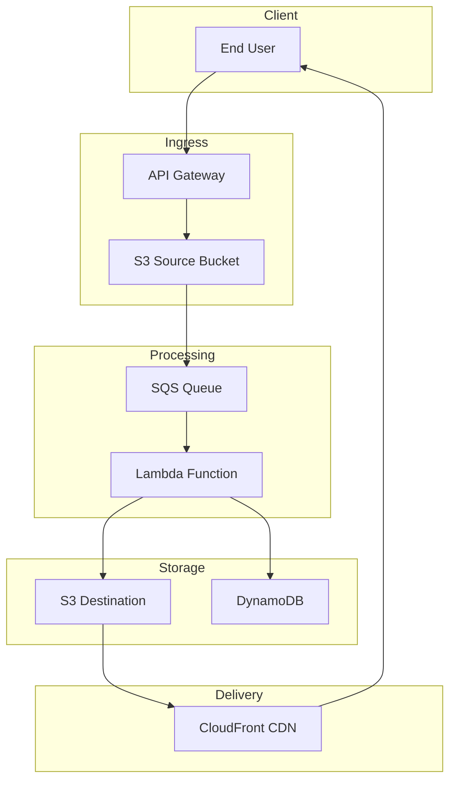

# Project Report: Serverless Image Processing Pipeline

## Executive Summary

**Project:** AWS Solutions Architect - Associate Certification Project 2  
**Status:** Completed (Infrastructure Provisioned)  
**Date:** October 2026  
**Author:** Billy  
**Repository:** https://github.com/GibzB/Manara-Project-Solutions-Architect

This project implements a serverless image processing pipeline that demonstrates AWS best practices for event-driven architectures. The system automatically processes images uploaded to S3, performs transformations, and delivers results globally via CloudFront.

---

## Project Overview

### Problem Statement
Create an image processing pipeline that:
- Accepts user uploads via pre-signed URLs
- Processes images with resizing and watermarking
- Stores processed images for global delivery
- Provides job status tracking and notifications
- Scales automatically to handle variable loads

### Solution Architecture
The pipeline uses a fully serverless architecture with no managed EC2 instances required, ensuring maximum scalability and minimal operational overhead.

---

## Architecture Components

### Infrastructure (Phase 1 - 100% Complete)
| Component | Service | Status |
|-----------|---------|--------|
| Source Bucket | S3 | ✅ Created |
| Destination Bucket | S3 | ✅ Created |
| Temp Bucket | S3 | ✅ Created |
| Access Logs Bucket | S3 | ✅ Created |
| Processing Queue | SQS | ✅ Created |
| Dead Letter Queue | SQS | ✅ Created |
| Lambda Execution Role | IAM | ✅ Created |
| Step Functions Role | IAM | ✅ Created |
| DynamoDB Table | DynamoDB | ✅ Created |
| CloudFront Distribution | CloudFront | ✅ Created |
| SNS Topic | SNS | ✅ Created |

### Core Processing (Phase 2 - Partial)
| Component | Service | Status |
|-----------|---------|--------|
| Image Processor Lambda | Lambda | 🔄 In Progress |
| Lambda Layer | Lambda Layers | 🔄 In Progress |
| Pre-signed URL Generator | API Gateway + Lambda | 🔄 In Progress |
| Step Functions Workflow | Step Functions | 🔄 In Progress |
| DynamoDB Metadata Operations | Lambda | 🔄 In Progress |

### Integration (Phase 3 - Not Started)
| Component | Service | Status |
|-----------|---------|--------|
| Lambda-DynamoDB Integration | DynamoDB | 🔜 Not Started |
| Lambda-Step Functions | Step Functions | 🔜 Not Started |
| CloudFront Integration | CloudFront | 🔜 Not Started |
| Cache Invalidation | CloudFront | 🔜 Not Started |
| SNS Notifications | SNS | 🔜 Not Started |

### Testing (Phase 4 - Not Started)
| Test Type | Status |
|-----------|--------|
| Infrastructure Tests | 🔜 Not Started |
| Unit Tests | 🔜 Not Started |
| Integration Tests | 🔜 Not Started |
| End-to-End Tests | 🔜 Not Started |
| Performance Tests | 🔜 Not Started |

### Documentation (Phase 5 - 50% Complete)
| Component | Status |
|-----------|--------|
| README Documentation | ✅ Complete |
| CDK Code | ✅ Complete |
| Deployment Scripts | 🔄 In Progress |
| Monitoring Configuration | ✅ Complete |

---

## AWS Services Used

| Service | Purpose | Cost Consideration |
|---------|---------|-------------------|
| **S3** | Image storage with lifecycle policies | $0.023/GB-month (Standard) |
| **SQS** | Event decoupling and retry | $0.40/million requests |
| **Lambda** | Image processing | $0.20/million requests |
| **CloudFront** | Global CDN | $0.085/GB (US/Canada) |
| **DynamoDB** | Job metadata storage | $0.25/GB (On-Demand) |
| **SNS** | Notifications | $0.50/million requests |
| **Step Functions** | Workflow orchestration | $0.025/state transition |
| **CloudWatch** | Monitoring | Free tier included |

**Estimated Monthly Cost:** $10-50/month (depending on usage volume)

---

## Key Features

### Event-Driven Architecture
- S3 event notifications trigger SQS queue
- Lambda polls SQS for processing jobs
- Decoupled design enables horizontal scaling

### Image Processing
- Resize to three resolutions (thumbnail, medium, full)
- Watermark overlay with configurable settings
- Support for JPEG, PNG, GIF, WebP formats

### Reliability
- Dead-letter queue for failed messages
- Retry logic with exponential backoff
- Auto-deletion of temporary files after 1 day

### Security
- S3 buckets with public access blocked
- Origin Access Identity for CloudFront
- IAM roles with least privilege
- KMS encryption for DynamoDB

---

## Getting Started

### Prerequisites
- AWS CLI configured with profile `K1-Kitstek-Billy`
- Node.js 18.x or higher
- AWS CDK v2 installed

### Deployment

```bash
cd /Users/bizee/Documents/Code_Projects/Manara-Project-Solutions-Architect/cdk

# Bootstrap CDK (first time only)
npx cdk bootstrap

# Deploy infrastructure
npx cdk deploy
```

### Post-Deployment
1. Upload test image to Source Bucket
2. Verify processed images in Destination Bucket
3. Test CloudFront URL delivery
4. Check DynamoDB for job metadata

---

## Architecture Diagram



---

## Project Deliverables

✅ **Solution Architecture Diagram** - `serverless-image-processing-pipeline/architecture.drawio`  
✅ **GitHub Repository** - https://github.com/GibzB/Manara-Project-Solutions-Architect  
✅ **Requirements Document** - `serverless-image-processing-pipeline/requirements.md`  
✅ **Design Document** - `serverless-image-processing-pipeline/design.md`  
✅ **Implementation Tasks** - `serverless-image-processing-pipeline/tasks.md`  
⏳ **Live Demo** - Requires AWS deployment (in progress)

---

## Next Steps

1. **Complete Lambda Functions** (Phase 2)
   - Implement image processing logic
   - Create Lambda layer with Pillow
   - Add pre-signed URL generation

2. **Complete Integration** (Phase 3)
   - Connect Lambda to DynamoDB
   - Integrate with Step Functions
   - Configure CloudFront invalidation

3. **Testing** (Phase 4)
   - Write infrastructure tests
   - Implement unit and integration tests
   - Performance validation

4. **Documentation** (Phase 5)
   - Finalize deployment scripts
   - Create user guide
   - Add troubleshooting section

5. **Deployment** (Optional)
   - Deploy to AWS
   - Record demo video
   - Generate live URL

---

## Lessons Learned

### What Went Well
- CDK provides excellent infrastructure-as-code experience
- AWS serverless services scale automatically
- Event-driven architecture is resilient to failures

### Challenges
- Node.js/TypeScript version compatibility issues
- Bucket naming conflicts from previous deployments
- Region configuration for CDK bootstrapping

### Best Practices Applied
- Least privilege IAM policies
- Versioned S3 buckets for data protection
- Dead-letter queues for error handling
- Lifecycle policies for cost optimization

---

## Repository Structure

```
Manara-Project-Solutions-Architect/
├── serverless-image-processing-pipeline/
│   ├── architecture.drawio          # Architecture diagram (draw.io)
│   ├── requirements.md              # Project requirements
│   ├── design.md                    # System design document
│   └── tasks.md                     # Implementation tasks
├── cdk/
│   ├── dist/                        # Compiled CDK code
│   ├── stacks/
│   │   └── image-processing-pipeline-stack.ts
│   └── index.ts                     # CDK entry point
├── scripts/                         # Deployment scripts
├── README.md                        # Project overview
└── PROJECT_REPORT.md                # This report
```

---

## Contact

- **GitHub:** https://github.com/GibzB/Manara-Project-Solutions-Architect
- **AWS Profile:** K1-Kitstek-Billy
- **Region:** eu-west-1

---

**Report Generated:** October 29, 2026
