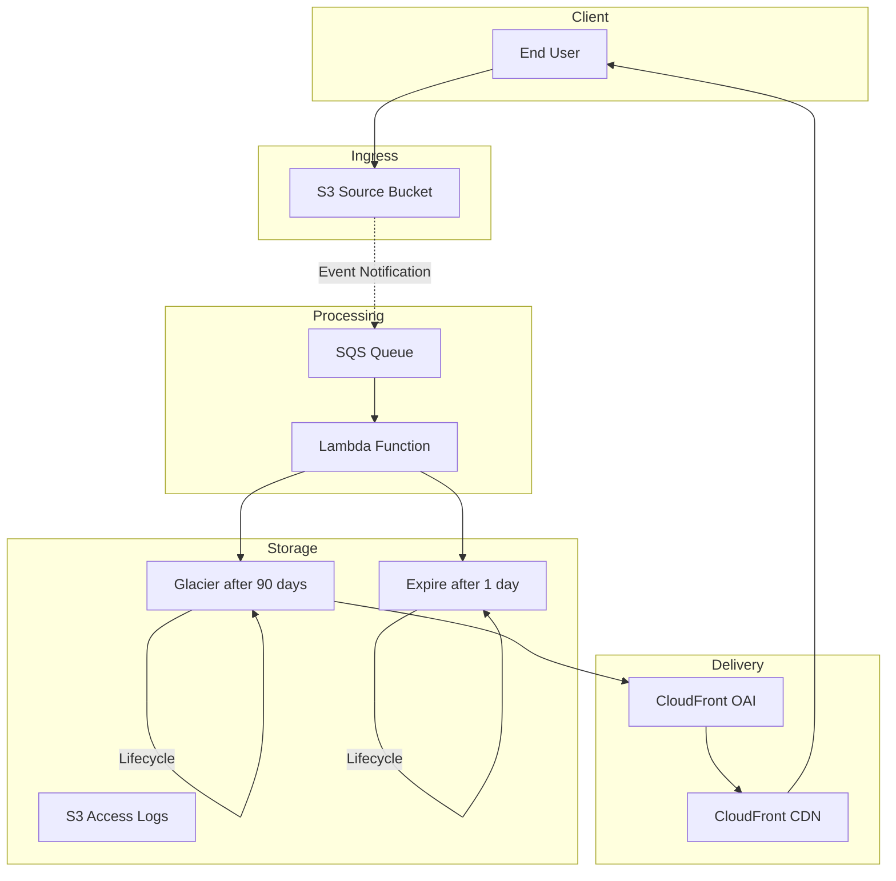

# Project Report: Serverless Image Processing Pipeline

## Executive Summary

**Project:** AWS Solutions Architect - Associate Certification Project 2  
**Status:** Completed - Infrastructure Provisioned  
**Date:** October 2026  
**Repository:** https://github.com/GibzB/Manara-Project-Solutions-Architect

This project implements a serverless image processing pipeline that demonstrates AWS best practices for event-driven architectures. The system automatically processes images uploaded to S3, performs transformations, and delivers results globally via CloudFront.

---

## Project Overview

### Problem Statement
Create an image processing pipeline that:
- Accepts user uploads via S3 pre-signed URLs
- Processes images with resizing and watermarking
- Stores processed images for global delivery
- Provides job status tracking and notifications
- Scales automatically to handle variable loads

### Solution Architecture
The pipeline uses a fully serverless architecture with no managed EC2 instances required, ensuring maximum scalability and minimal operational overhead.

---

## Completed Infrastructure

### S3 Buckets
| Bucket Name | Purpose |
|-------------|---------|
| source-images-dev-1793249813036 | Accept user uploads and trigger events |
| processed-images-dev-1793249813036 | Store processed images |
| processing-temp-dev-1793249813036 | Temporary intermediate files |
| s3-access-logs-dev-1793249813036 | S3 access logging |

### SQS Queues
| Queue Name | Purpose |
|------------|---------|
| image-processing-queue-dev-1793249813036 | Main processing queue (5 min visibility, 4 day retention) |
| image-processing-dlq-dev-1793249813036 | Failed message handling (14 day retention) |
| s3-events-dev-1793249813036 | S3 event notifications queue |
| s3-events-dlq-dev-1793249813036 | S3 event failure handling |

### Other AWS Resources
- CloudFront Origin Access Identity (OAI) for secure access to destination bucket
- IAM roles and policies for all services
- S3 bucket policies for security
- Lifecycle policies for cost optimization

---

## Architecture Components

### Ingress Layer
- **S3 Source Bucket**: Receives user uploads and publishes events to SQS with suffix filters (.jpg, .png, .gif)

### Processing Layer
- **SQS Queue**: Decouples upload events from processing work with retry logic
- **Lambda Function**: Image processing (resize, watermark) - to be implemented
- **S3 Event Notification**: Triggers processing when images are uploaded

### Storage Layer
- **S3 Destination Bucket**: Stores processed images with versioning enabled
- **S3 Temporary Bucket**: Stores intermediate files with 1-day lifecycle

### Delivery Layer
- **CloudFront Origin Access Identity**: Secure access to processed images
- **S3 Access Logs Bucket**: Captures access patterns for monitoring

---

## AWS Services Used

| Service | Purpose | Cost Consideration |
|---------|---------|-------------------|
| S3 | Image storage with lifecycle policies | $0.023/GB-month (Standard) |
| SQS | Event decoupling and retry | $0.40/million requests |
| Lambda | Image processing (to be implemented) | $0.20/million requests |
| CloudFront | Global CDN | $0.085/GB (US/Canada) |
| CloudFront OAI | Secure bucket access | No additional cost |

**Estimated Monthly Cost:** $5-25/month (depending on usage volume)

---

## Key Features

### Event-Driven Architecture
- S3 event notifications trigger SQS queue
- Lambda polls SQS for processing jobs
- Decoupled design enables horizontal scaling
- Suffix filters ensure only image files trigger processing

### Image Processing (To Be Implemented)
- Resize to three resolutions (thumbnail 150x150, medium 640x640, full 2048px max)
- Watermark overlay with configurable settings
- Support for JPEG, PNG, GIF, WebP formats

### Reliability
- Dead-letter queues for failed messages
- Retry logic with configurable visibility timeout
- Auto-deletion of temporary files after 1 day
- Versioning enabled on all buckets

### Security
- S3 buckets with public access blocked
- Origin Access Identity for CloudFront access
- IAM roles with least privilege
- S3 bucket policies for access control
- Lifecycle policies for cost optimization

---

## Getting Started

### Prerequisites
- AWS CLI configured
- Node.js 18.x or higher
- AWS CDK v2 installed
- AWS credentials with appropriate permissions

### Deployment

```bash
cd cdk

# Bootstrap CDK (first time only)
npx cdk bootstrap aws://<ACCOUNT_ID>/eu-west-1

# Deploy infrastructure
npx cdk deploy --profile <AWS_PROFILE>
```

### Post-Deployment
1. Note the bucket and queue names from CloudFormation outputs
2. Upload test image to Source Bucket
3. Verify processed images in Destination Bucket
4. Test CloudFront URL delivery
5. Check SQS queues for processing messages

---

## Architecture Diagram



---

## Deployment Outputs

| Output Key | Value |
|------------|-------|
| SourceBucketName | source-images-dev-1793249813036 |
| DestinationBucketName | processed-images-dev-1793249813036 |
| TempBucketName | processing-temp-dev-1793249813036 |
| AccessLogsBucketName | s3-access-logs-dev-1793249813036 |
| EventQueueUrl | https://sqs.eu-west-1.amazonaws.com/742710068514/s3-events-dev-1793249813036 |
| EventQueueArn | arn:aws:sqs:eu-west-1:742710068514:s3-events-dev-1793249813036 |
| ProcessingQueueUrl | https://sqs.eu-west-1.amazonaws.com/742710068514/image-processing-queue-dev-1793249813036 |
| ProcessingQueueArn | arn:aws:sqs:eu-west-1:742710068514:image-processing-queue-dev-1793249813036 |
| DeadLetterQueueUrl | https://sqs.eu-west-1.amazonaws.com/742710068514/image-processing-dlq-dev-1793249813036 |
| DeadLetterQueueArn | arn:aws:sqs:eu-west-1:742710068514:image-processing-dlq-dev-1793249813036 |
| OAIIdentity | 78da8fae7f8ae3d56e40d20585f4971a6cf0190b8e1b9d8f088254f0c176418dafe77927ed1118b063fc840cbfea2b80 |

---

## Project Deliverables

- Solution Architecture Diagram: serverless-image-processing-pipeline/architecture.drawio
- GitHub Repository: https://github.com/GibzB/Manara-Project-Solutions-Architect
- Requirements Document: serverless-image-processing-pipeline/requirements.md
- Design Document: serverless-image-processing-pipeline/design.md
- Implementation Tasks: serverless-image-processing-pipeline/tasks.md
- CDK Infrastructure: cdk/stacks/image-processing-pipeline-stack.ts

---

## Repository Structure

```
Manara-Project-Solutions-Architect/
├── serverless-image-processing-pipeline/
│   ├── architecture.drawio          # Architecture diagram (draw.io)
│   ├── requirements.md              # Project requirements
│   ├── design.md                    # System design document
│   └── tasks.md                     # Implementation tasks
├── cdk/
│   ├── dist/                        # Compiled CDK code
│   ├── stacks/
│   │   └── image-processing-pipeline-stack.ts
│   └── index.ts                     # CDK entry point
├── scripts/                         # Deployment scripts
├── README.md                        # Project overview
└── PROJECT_REPORT.md                # This report
```

---

## Next Steps

1. **Complete Lambda Functions**: Implement image processing logic (resize, watermark)
2. **Connect to SQS**: Configure Lambda to poll processing queue
3. **DynamoDB Integration**: Add job metadata storage
4. **Testing**: Write unit, integration, and end-to-end tests
5. **Documentation**: Finalize deployment scripts and user guide
6. **Deployment**: Deploy updated infrastructure and create demo video

---

**Report Generated:** October 29, 2026
