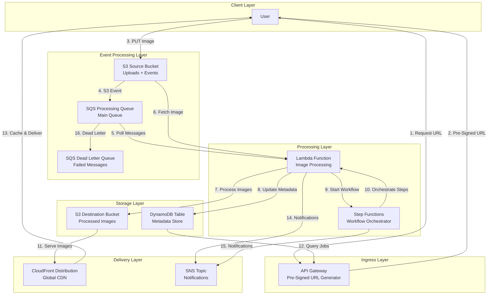
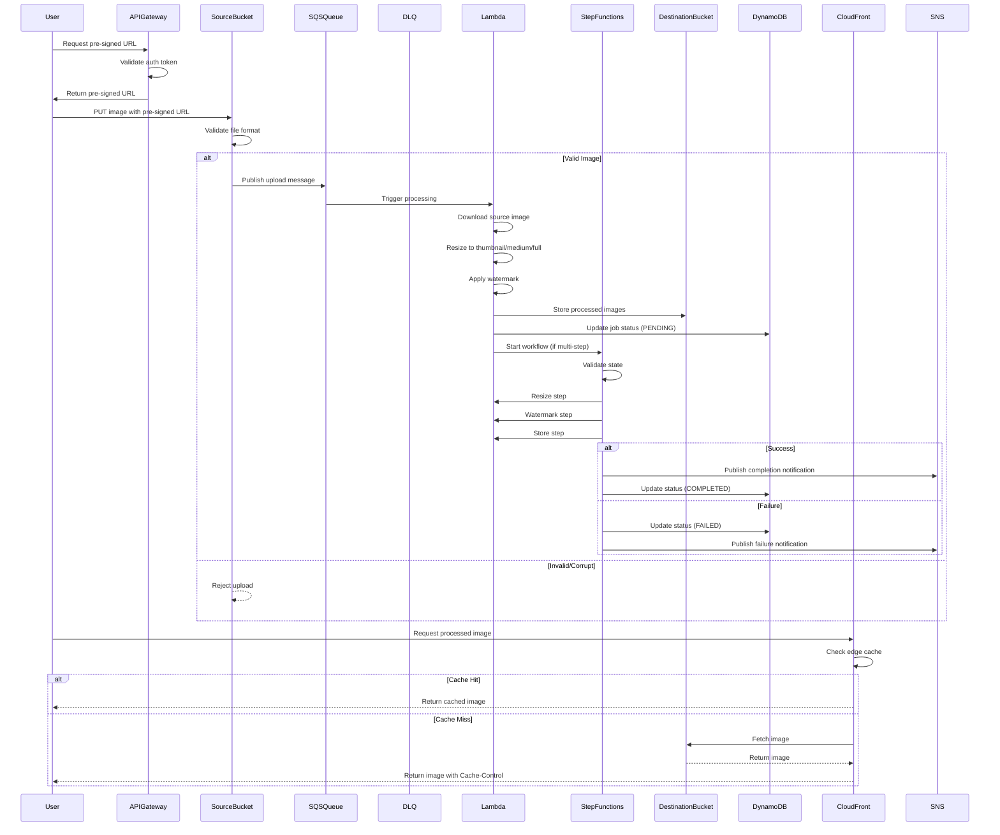
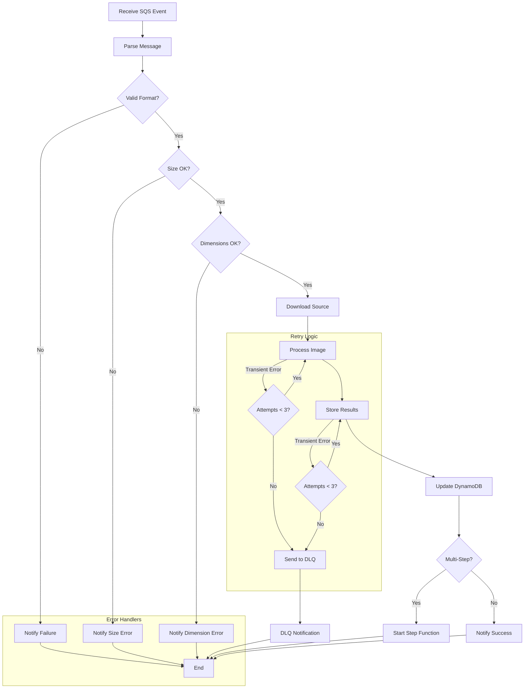

# Design Document: Serverless Image Processing Pipeline

## Overview

This design document outlines the architecture for a serverless image processing pipeline that automatically processes images uploaded to Amazon S3. The system uses event-driven patterns with Amazon SQS for decoupling, AWS Lambda for image transformations (resizing and watermarking), AWS Step Functions for workflow orchestration, Amazon DynamoDB for metadata storage, Amazon CloudFront for global image delivery, and Amazon SNS for notifications.

The architecture demonstrates AWS best practices including loose coupling, automatic scaling, and cost-effective storage management through lifecycle policies. All components are serverless with no VPC requirements, ensuring maximum scalability and minimal operational overhead.

## Architecture

### System Architecture Diagram



### Data Flow Sequence



## Components and Interfaces

### S3 Buckets

| Bucket | Purpose | Access Pattern |
|--------|---------|----------------|
| `source-images-[env]` | Accept user uploads and trigger events | S3 PUT via pre-signed URLs, S3 Events to SQS |
| `processed-images-[env]` | Store processed images | Read via CloudFront OAI only |
| `processing-temp-[env]` | Temporary intermediate files | Lambda only |
| `s3-access-logs-[env]` | S3 access logging | Write only (S3 to S3) |

### SQS Queues

| Queue | Purpose | Configuration |
|-------|---------|---------------|
| `image-processing-queue` | Main processing queue | 5min visibility, 3 max receive count |
| `image-processing-dlq` | Failed message handling | 14-day retention, SNS notifications |

### Lambda Function

| Component | Purpose | Runtime |
|-----------|---------|---------|
| `image-processor` | Main processing handler | Python 3.11 or Node.js 18.x |
| `presigned-url-generator` | Generate pre-signed URLs | Python 3.11 |

**Interface**:
```typescript
// SQS Event Handler
interface SQSEvent {
  Records: {
    messageId: string;
    body: string; // S3 event JSON
  }[];
}

// Lambda Response
interface LambdaResponse {
  statusCode: number;
  body: {
    jobId: string;
    status: 'success' | 'failed';
    outputs: string[];
  };
}
```

### Step Functions

| State Machine | Purpose | States |
|--------------|---------|--------|
| `image-processing-workflow` | Multi-step orchestration | Validate → Resize → Watermark → Store |

**Input Interface**:
```json
{
  "jobId": "string",
  "userId": "string",
  "sourceBucket": "string",
  "sourceKey": "string",
  "outputPrefix": "string"
}
```

### DynamoDB Table

| Table | Primary Key | GSI |
|-------|-------------|-----|
| `image-processing-metadata` | userId (PK), jobId (SK) | UserIdStatusIndex |

**Schema**:
| Attribute | Type | Description |
|-----------|------|-------------|
| `userId` | String | User identifier |
| `jobId` | String | Unique job ID |
| `processingStatus` | String | PENDING \| IN_PROGRESS \| COMPLETED \| FAILED |
| `thumbnailUrl` | String | Processed thumbnail URL |
| `mediumUrl` | String | Processed medium URL |
| `fullResolutionUrl` | String | Processed full-resolution URL |

### CloudFront Distribution

| Distribution | Origin | Cache Policy |
|--------------|--------|--------------|
| `image-processing-cdn` | Destination Bucket (OAI) | CachingOptimized |

### SNS Topics

| Topic | Publisher | Subscriber Types |
|-------|-----------|------------------|
| `image-processing-notifications` | Lambda, Step Functions | Email, Lambda, HTTP, SQS |

## Data Models

### Job Metadata Model

```typescript
interface ProcessingJob {
  userId: string;              // Partition Key
  jobId: string;               // Sort Key
  originalUrl: string;
  originalSize: number;        // bytes
  originalDimensions: string;  // "WxH"
  
  // Processing outputs
  thumbnailUrl: string | null;
  mediumUrl: string | null;
  fullResolutionUrl: string | null;
  
  // Status tracking
  processingStatus: 'PENDING' | 'IN_PROGRESS' | 'COMPLETED' | 'FAILED';
  currentStep: 'validate' | 'resize' | 'watermark' | 'store';
  progressPercentage: number;  // 0-100
  
  // Timestamps
  createdAt: string;   // ISO-8601
  startedAt: string;   // ISO-8601
  completedAt: string; // ISO-8601 (null if not complete)
  
  // Error details
  errorDetails: string | null;
  processingTimeMs: number | null;
}
```

### SQS Message Model

```typescript
interface SQSMessageBody {
  Records: {
    eventSource: 'aws:s3';
    s3: {
      bucket: {
        name: string;
      };
      object: {
        key: string;
        size: number;
       sequencenumber?: string;
      };
    };
  }[];
}
```

### SNS Notification Model

```typescript
interface JobCompletedNotification {
  notificationType: 'JOB_COMPLETED';
  jobId: string;
  userId: string;
  originalUrl: string;
  outputUrls: {
    thumbnail: string;
    medium: string;
    fullResolution: string;
  };
  processingTimeMs: number;
  completedAt: string; // ISO-8601
}

interface JobFailedNotification {
  notificationType: 'JOB_FAILED';
  jobId: string;
  userId: string;
  originalUrl: string;
  errorMessage: string;
  retryCount: number;
  failedAt: string; // ISO-8601
}
```

### CloudFront Cache Invalidation Request

```typescript
interface InvalidationRequest {
  DistributionId: string;
  InvalidationBatch: {
    Paths: {
      Quantity: number;
      Items: string[];
    };
    CallerReference: string; // Timestamp or UUID
  };
}
```

## Error Handling

### Error Classification

| Error Type | Retry Logic | DLQ | Notification |
|------------|-------------|-----|--------------|
| Invalid file format | No (permanent) | Yes | Yes |
| File too large (>10MB) | No (permanent) | Yes | Yes |
| Image dimensions too large | No (permanent) | Yes | Yes |
| Corrupted image | No (permanent) | Yes | Yes |
| Temporary S3 timeout | Yes (3x, exponential) | Yes | Yes |
| Lambda execution timeout | Yes (SQS visibility timeout) | Yes | Yes |
| DynamoDB write failure | Yes (3x) | Yes | Yes |
| SNS publish failure | Yes (3x, SNS retry) | Yes | Yes |

### Lambda Error Handling Flow



### Step Functions Error Handling

| State | Retry Config | Error Path |
|-------|--------------|------------|
| All states | 3 attempts, exponential backoff | Fail with error details |
| ValidateInput | 3x, max delay 30s | Publish failure notification |
| ResizeImages | 3x, max delay 30s | Update metadata to FAILED |
| ApplyWatermark | 3x, max delay 30s | Notify failure |
| StoreResults | 3x, max delay 30s | Notify failure |
| UpdateMetadata | 3x, max delay 30s | Notify failure |

### S3 Event Notification Failure

| Scenario | Behavior |
|----------|----------|
| SQS queue unavailable | S3 retries for 24 hours |
| SQS rejects message | S3 retries for 24 hours |
| Message in DLQ | SNS notification sent |
| No DLQ configured | Message lost (not recommended) |

## Testing Strategy

### Infrastructure Tests (Snapshot Tests)

**Test Framework**: AWS CDK Assertions

**Test Coverage**:
- Verify S3 bucket versioning enabled
- Verify CloudFront OAI configured correctly
- Verify IAM policies have least privilege
- Verify DynamoDB PITR enabled
- Verify SNS topic policy restricts publishers
- Verify SQS queue configurations (visibility timeout, max receive count)
- Verify Lambda environment variables set correctly
- Verify Step Functions state machine states defined correctly

**Example Tests**:
```typescript
// CDK Snapshot Test
import { App } from 'aws-cdk-lib';
import { Template } from 'aws-cdk-lib/assertions';
import { ImageProcessingPipelineStack } from '../lib/image-processing-pipeline-stack';

test('S3 buckets configured correctly', () => {
  const app = new App();
  const stack = new ImageProcessingPipelineStack(app, 'TestStack');
  const template = Template.fromStack(stack);
  
  template.hasResourceProperties('AWS::S3::Bucket', {
    VersioningConfiguration: {
      Status: 'Enabled'
    }
  });
});

test('IAM policies have least privilege', () => {
  const app = new App();
  const stack = new ImageProcessingPipelineStack(app, 'TestStack');
  const template = Template.fromStack(stack);
  
  template.hasResourceProperties('AWS::IAM::Policy', {
    PolicyDocument: {
      Statement: [/* verify specific permissions */]
    }
  });
});
```

### Unit Tests

**Test Framework**: PyTest (Python) or Jest (Node.js)

**Test Coverage**:
- Image resizing with various formats (JPEG, PNG, GIF, WebP) and sizes
- Watermark application with different positions (top-left, top-right, bottom-left, bottom-right, center)
- Watermark opacity (0.1 to 1.0) and scale (10% to 50%)
- File validation (format detection, size limits, dimension limits)
- Error handling (corrupted files, missing watermarks, S3 failures)
- DynamoDB CRUD operations (create, read, update, query)
- SNS notification publishing (success and failure)

**Example Tests**:
```python
# Test image resizing
def test_resize_image_thumbnail():
    image = generate_random_image(width=1920, height=1080)
    thumbnail = resize_to_thumbnail(image)
    assert thumbnail.width <= 150
    assert thumbnail.height <= 150
    assert thumbnail.format == image.format

# Test watermark application
def test_watermark_applied_correctly():
    image = generate_random_image()
    watermarked = apply_watermark(image, position='bottom-right', opacity=0.5)
    assert watermarked.width == image.width
    assert watermarked.height == image.height

# Test DynamoDB operations
def test_job_metadata_updated():
    job = create_test_job()
    save_job_metadata(job)
    retrieved = get_job_metadata(job.userId, job.jobId)
    assert retrieved.jobId == job.jobId
    assert retrieved.processingStatus == 'PENDING'
```

### Integration Tests

**Test Scenarios**:

1. **End-to-End Workflow**:
   - Upload image to Source Bucket
   - Verify SQS message published
   - Verify Lambda processes image
   - Verify processed images in Destination Bucket
   - Verify DynamoDB metadata updated
   - Verify CloudFront can serve image

2. **Retry Logic**:
   - Simulate temporary S3 failure
   - Verify Lambda retries up to 3 times
   - Verify message returned to queue between retries
   - Verify DLQ receives message after max retries

3. **Visibility Timeout**:
   - Process large image (exceeds default timeout)
   - Verify message not reprocessed by other Lambda
   - Verify message deleted after successful completion

4. **Step Functions**:
   - Start workflow with multi-step processing
   - Verify state transitions in order
   - Verify failure in one state doesn't proceed
   - Verify completion notification sent

5. **CloudFront Cache**:
   - Request image via CloudFront URL
   - Verify cache miss, fetch from origin
   - Verify second request is cache hit
   - Verify invalidation updates cache

### Performance Tests

**Benchmarks**:
- Image processing time: < 2000ms for 5MB images
- DynamoDB query latency: < 500ms for user queries
- CloudFront cache hit ratio: > 90% for repeated requests
- SQS message visibility timeout: Adjust based on actual processing time

### Deployment Validation Tests

1. **Smoke Test**:
   - Deploy infrastructure via CDK
   - Upload test image to Source Bucket
   - Verify processed image appears in Destination Bucket
   - Verify CloudFront can serve image
   - Verify DynamoDB metadata created

2. **Health Check**:
   - Verify Lambda can read from SQS
   - Verify DynamoDB connectivity
   - Verify CloudFront distribution healthy
   - Verify SNS topic accessible

3. **Load Test**:
   - Upload 100 images simultaneously
   - Verify all processed within expected time
   - Verify no messages lost in SQS
   - Verify no Lambda throttling